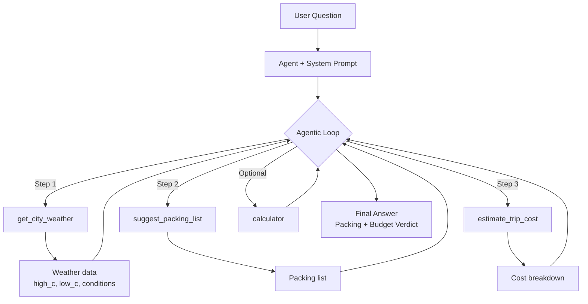
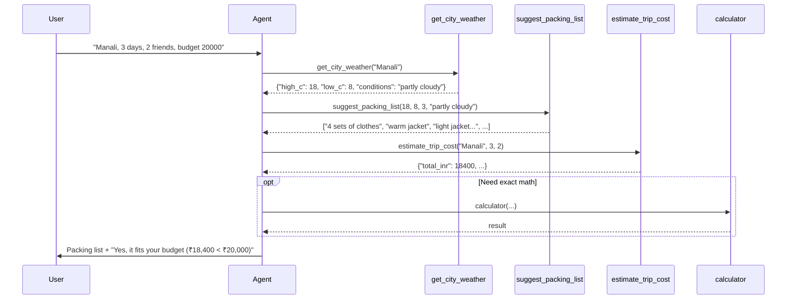
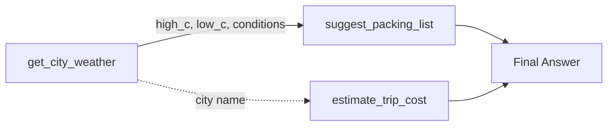
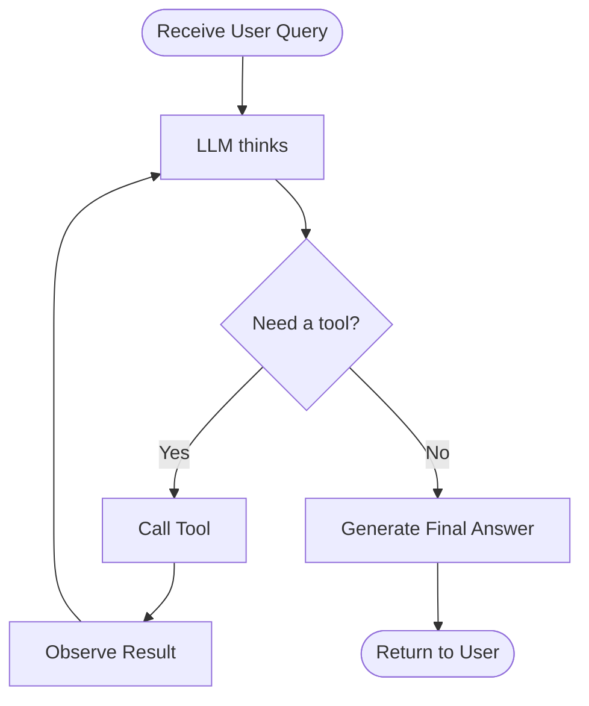

# Travel Assistant Agent — Capstone Project

> **Goal**: Build an agentic travel planner that *decides its own tool sequence*  
> (exactly the opposite of a hard-coded script).

---

## 1. Project Overview

This agent answers natural-language travel questions such as:

> “I’m going to Manali for 4 days with 2 friends. Budget is ₹15,000. What should I pack and does it fit my budget?”

It automatically:

1. Checks the **weather** of the destination
2. Suggests a **packing list** based on that weather
3. Estimates the **trip cost**
4. Compares the cost against the user’s **budget**
5. Gives a clear final answer

No one hard-coded the order of these steps — the agentic loop figures it out.

---

## 2. High-Level Architecture



---

## 3. Detailed Tool Call Flow



---

## 4. Tools Breakdown

| Tool                    | Purpose                              | Inputs                          | Output Example |
|-------------------------|--------------------------------------|---------------------------------|----------------|
| `get_city_weather`      | Fetch real weather                   | `city: str`                     | `{"high_c": 32, "low_c": 26, "conditions": "humid, occasional showers"}` |
| `suggest_packing_list`  | Recommend clothes & gear             | `high_c, low_c, days, conditions` | List of items |
| `estimate_trip_cost`    | Rough cost in INR                    | `city, days, travellers`        | Cost breakdown dict |
| `calculator`            | Community tool for arithmetic        | Expression                      | Numeric result |

### Tool Dependency Graph



---

## 5. System Prompt (The Brain)

```text
You are a practical travel assistant. 
When asked about a trip: check the weather first, then suggest what to pack 
based on that weather, then estimate the cost. 
Always say whether the trip fits the user's budget, and keep advice concise.
```

This prompt is the only place that “guides” the agent.  
The actual sequence is discovered at runtime by the agentic loop.

---

## 6. How the Agentic Loop Works



Key insight from the original Module 1 example:

> “Nobody wrote that sequence — the loop worked it out.”

---

## 7. Example Execution

**Command**
```bash
python travel_assistant.py "I'm going to Manali for 3 days with 2 friends. My budget is 20000 rupees. What should I pack, and does it fit my budget?"
```

**Typical internal tool calls**
1. `get_city_weather("Manali")`
2. `suggest_packing_list(high_c=..., low_c=..., days=3, conditions=...)`
3. `estimate_trip_cost("Manali", 3, 2)`
4. (optional) `calculator` for final budget comparison

**Sample Final Answer**
```
Weather in Manali: High 18°C / Low 8°C, partly cloudy.

Recommended packing:
- 4 sets of clothes
- toiletries
- phone charger
- warm jacket
- thermal layer
- light jacket for evenings

Estimated cost: ₹18,400  
Your budget: ₹20,000  

✅ Yes, the trip fits your budget with about ₹1,600 left.
```

---

## 8. File Structure

```
.
├── travel_assistant.py          # Main agent script
├── config.py                    # Contains MODEL_ID
├── TRAVEL_ASSISTANT.md          # This documentation
└── requirements.txt             # strands, requests, etc.
```

---

## 9. Running the Project

```bash
# Install dependencies
pip install strands strands-tools requests

# Run with default question
python travel_assistant.py

# Run with custom question
python travel_assistant.py "Goa for 5 days, 3 people, budget 40000"
```

---

## 10. Skills Practiced

| Skill                        | Where it appears                          |
|-----------------------------|-------------------------------------------|
| Custom tools (`@tool`)      | All three weather / packing / cost tools  |
| Type hints + Docstrings     | Every tool                                |
| Tools feeding into each other | Weather → Packing list                  |
| Community tool              | `calculator`                              |
| System prompt               | Guides the overall strategy               |
| Agentic loop                | Multi-step planning without hard-coding   |

---

**You have now closed the loop**:  
You started Module 1 by *using* a travel planner.  
You finish by *building* one yourself.  
